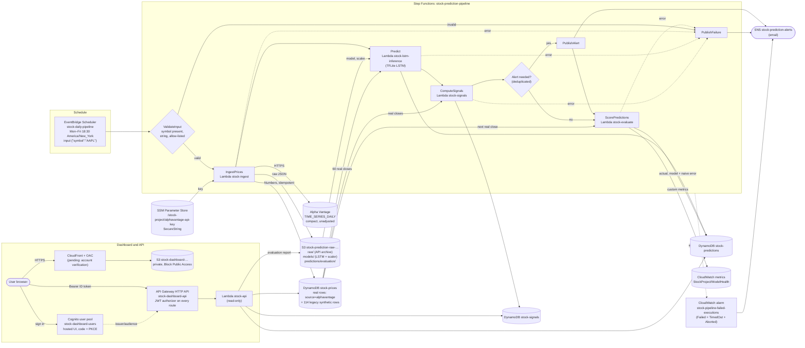
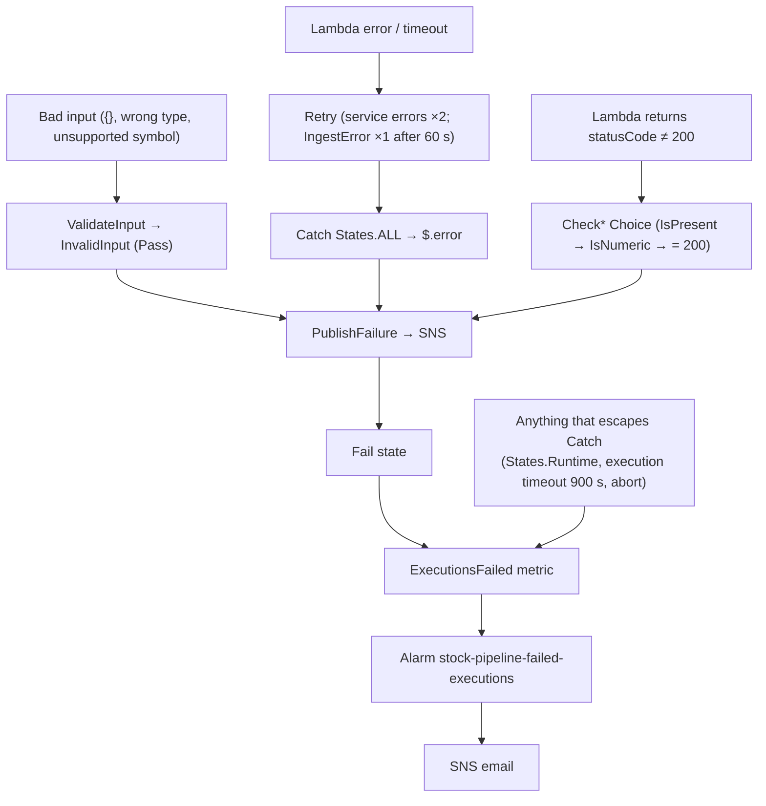

# Architecture — Cloud Stock Price Monitoring and Prediction

Region `ap-south-1` (Mumbai), account `542601847637`. Everything is serverless and pay-per-use.
Verified live on 2026-10-05 unless marked **pending**.

## End-to-end flow

## Failure handling

## Design decisions
| Decision | Why |
|---|---|
| Real and synthetic rows share `stock-prices`; real rows carry `source=alphavantage`, `data_type=real`, and every reader filters on `source` | The user ruled out deleting anything. Real sort keys are the US close time in UTC (20:00Z/21:00Z), which never collide with the synthetic keys (00:00Z, 10:19Z, 10:24Z); writes are conditional so a non-Alpha-Vantage row can never be overwritten. |
| Prices stored as DynamoDB Numbers (Python `Decimal`) | The audit found `close` stored as String in 104 legacy rows. |
| Idempotent ingestion | Rows are keyed by (symbol, close time); unchanged rows are skipped; re-runs give `inserted 0, unchanged 100`. |
| One prediction per (symbol, as_of_date) | Re-running the pipeline on the same data overwrites rather than duplicates. |
| Alert at most once per trading day, only on transitions | Prevents email spam; no daily "success" email. |
| Scoring runs last in the pipeline and writes each score once | A scoring failure can't block the prediction or the alert; `attribute_not_exists(scored_at)` makes re-runs harmless. |
| No model-health verdict below 20 scored days | One or two days of errors say nothing about accuracy; the API and dashboard show "insufficient data" instead. |
| Schedule 18:30 New York time, Mon–Fri | 2.5 h after the 16:00 close, so Alpha Vantage has the day's bar; `America/New_York` handles DST. On US holidays the run is a harmless no-op (no new row, same prediction key, alert deduplicated). |
| HTTP API + Cognito JWT authorizer | Cheapest API Gateway type; no route is reachable without a valid Cognito token. |
| Private S3 + CloudFront OAC (no public website) | The user's requirement; the bucket keeps all four Block Public Access settings on. |
