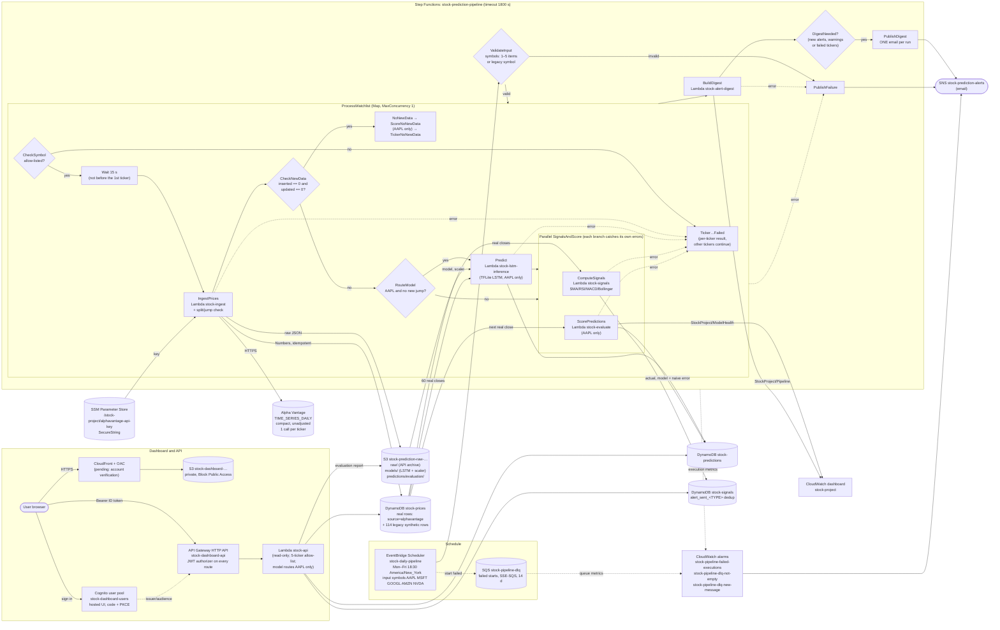
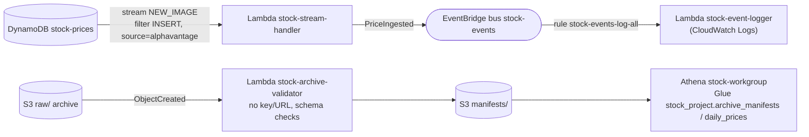
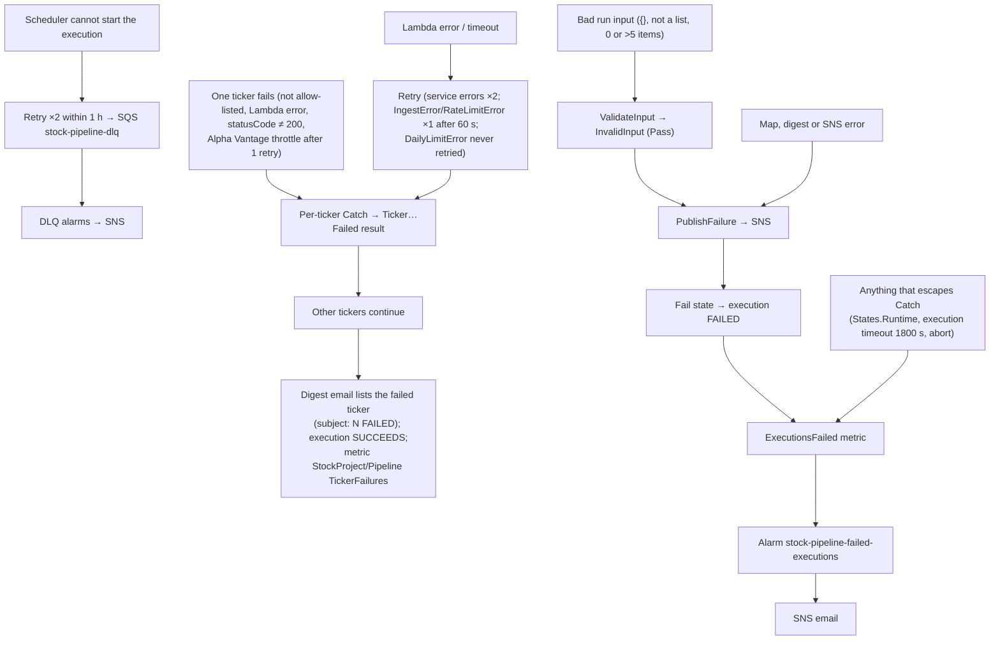

# Architecture — Cloud Stock Price Monitoring and Prediction

Region `ap-south-1` (Mumbai), account `542601847637`. Everything is serverless and pay-per-use.
Verified live on 2026-10-05; watchlist, digest, DLQ and dashboard parts verified 2026-10-15; events, validator, Athena (2026-10-22), parallel/skip definition, X-Ray and the `stock-api:live` alias verified 2026-10-26. Items marked **pending** are not live.

## End-to-end flow (parallel/skip definition, live since 2026-10-26 04:06 UTC)

`APIGW → API` goes through alias `stock-api:live` (version 3 since 2026-10-26). X-Ray active tracing is on for the 8 project Lambdas (not `stock-lstm-inference`); HTTP APIs and (for now) the state machine are not traced.

## Event-driven side paths (added 2026-10-22)

Verified live: real INSERTs from the scheduled runs of 2026-10-22 and 10-23 produced 10 `PriceIngested` events in the logger log; every new archive got an `ok` manifest.

Legacy input `{"symbol":"AAPL"}` is still accepted (wrapped into a one-item list by `LegacyInput`), so older manual tests keep working.

## Failure handling

## Design decisions
| Decision | Why |
|---|---|
| Real and synthetic rows share `stock-prices`; real rows carry `source=alphavantage`, `data_type=real`, and every reader filters on `source` | The user ruled out deleting anything. Real sort keys are the US close time in UTC (20:00Z/21:00Z), which never collide with the synthetic keys (00:00Z, 10:19Z, 10:24Z); writes are conditional so a non-Alpha-Vantage row can never be overwritten. |
| Prices stored as DynamoDB Numbers (Python `Decimal`) | The audit found `close` stored as String in 104 legacy rows. |
| Idempotent ingestion | Rows are keyed by (symbol, close time); unchanged rows are skipped; re-runs give `inserted 0, unchanged 100`. |
| One prediction per (symbol, as_of_date) | Re-running the pipeline on the same data overwrites rather than duplicates. |
| Alerts only on transitions, deduplicated per (symbol, trading day, alert type); ONE combined email per run | Prevents spam and never drops a second rule that fires for the same ticker and day; no daily "success" email. |
| Watchlist as a Map with MaxConcurrency 1 and a 15 s wait | Alpha Vantage free tier allows 25 calls/day and throttles bursts; 5 tickers = 5 calls per run. Sequential processing keeps calls spaced. |
| A failed ticker does not fail the run | Each ticker is isolated by its own Catch; the single digest email reports the failure, so there is one email instead of an email plus an alarm (decision D5 in `docs/RUN-REPORT.md`). |
| Predictions only for AAPL | The LSTM was trained on AAPL only and does not beat a naive baseline; other tickers get prices and signals only, and the API returns 404 "no validated model" for them. |
| Skip the AAPL prediction when new data contains a ≥ 25% day-over-day jump | Prices are unadjusted, so a stock split looks like a crash; feeding it to the model would produce a meaningless prediction. |
| Separate digest Lambda | Its role can only write its logs and `StockProject/Pipeline` metrics; it reads no data. |
| Scoring runs in parallel with signals and writes each score once | Neither branch can cancel the other (each catches its own errors); `attribute_not_exists(scored_at)` makes re-runs harmless. |
| Skip Predict and Signals only when `inserted == 0 and updated == 0` | Owner decision B (2026-10-22). Nothing new means the prediction and signals would be identical; score still runs for AAPL. Alpha Vantage often revises the last bar's volume, so `updated` is usually 1 after a trading day. |
| API served through a Lambda alias | The integration points at `stock-api:live`; a bad deploy is rolled back by moving the alias, without touching API Gateway. |
| No model-health verdict below 20 scored days | One or two days of errors say nothing about accuracy; the API and dashboard show "insufficient data" instead. |
| Schedule 18:30 New York time, Mon–Fri | 2.5 h after the 16:00 close, so Alpha Vantage has the day's bar; `America/New_York` handles DST. On US holidays the run is a harmless no-op (no new row, same prediction key, alert deduplicated). |
| HTTP API + Cognito JWT authorizer | Cheapest API Gateway type; no route is reachable without a valid Cognito token. |
| Private S3 + CloudFront OAC (no public website) | The user's requirement; the bucket keeps all four Block Public Access settings on. |
